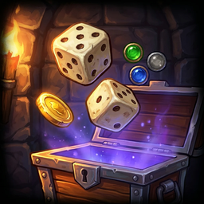

# Group Loot Forever

<p align="center"></p>

A [WoW Forever](https://www.wowhead.com/forever) addon for group loot rolls. It counts
who picked Need, Greed or Pass, and who has not picked yet. Hover for the names, in
class colours, each with its level.

On the game's own roll frame, each button gets a number in its corner, its tooltip
gets the names, and "Pending N" sits beside the frame:

```
┌──────────────────────────────────────────┐
│ [icon] Electrocutioner Leg  [Need]² [Greed]¹ [Pass]¹ │  Pending 2
└──────────────────────────────────────────┘
          hover Need:  Need
                       Thrall (34)
```

The game closes that frame once you pick. From then on the roll stays in a small panel
until it ends, so you can watch the rest of the group decide:

```
┌───────────────────────────────────────────────────────────────┐
│ [icon] Electrocutioner Leg  Pending 2  Need 1  Greed 1  Pass 1 │
└───────────────────────────────────────────────────────────────┘
```

Disenchant and Transmog get a count too, once someone picks them. It all works in combat.

## Install

Copy the `GroupLootForever` folder to
`World of Warcraft\_forever_\Interface\AddOns\GroupLootForever`, then log in or `/reload`.

## Commands

| Command | |
|---|---|
| `/glf test` | a made-up roll for 30 seconds, on a copy of the game's roll frame; click a button and it moves to the panel, as after a real pick. Drag the panel to place it |
| `/glf reset` | put the panel back in its place (drag it to move it) |
| `/glf debug` | turn the debug log on or off |

## How it knows

Each pick is read from the loot lines in chat ("Thrall has selected Need for: ..."), in
the game's own wording, so other languages work too. Who can roll is the group, online,
when the roll starts. The game's loot history, when it lists the players of a drop,
replaces that list and adds Transmog.

Someone out of range gets no roll. Unless the loot history says otherwise, they show as
pending until the roll ends.

## Debug log

Tick it with `/glf debug`, roll for something and `/reload`. The log is in
`WTF\Account\<account>\SavedVariables\GroupLootForever.lua`.

## License

MIT. See [LICENSE](LICENSE).
